  

  
  
  

## 👋 Sobre mim

Graduando em **Defesa Cibernética pela FIAP** (conclusão em dezembro de 2026), com foco em **SOC e detecção de ameaças**.
Aprendo construindo: pesquiso vulnerabilidades, analiso malware em sandbox e mantenho um laboratório de redes e segurança.

Procuro **estágio, trainee ou vaga júnior** em SOC, Blue Team e áreas correlatas (presencial, híbrido ou remoto).

## 🔍 No que estou trabalhando

| Área | O que faço |
| --- | --- |
| 🛡️ **Investigação de alertas** | Triagem de phishing com Splunk (SPL) em labs do TryHackMe |
| 🦠 **Análise de malware** | Análise estática e dinâmica em sandbox isolada (REMnux), com extração de IOCs e relatórios |
| 🐞 **Pesquisa de vulnerabilidades** | Reports de DLL hijacking em aplicações Windows no HackerOne (severidade alta, CVSS 7.3 a 8.2), com PoCs |
| 🧪 **Laboratório próprio** | 6 VMs: LAN corporativa simulada com pfSense e ambiente isolado para análise de malware |

> Os reports do HackerOne foram validados como duplicados e seguem sob confidencialidade do programa, então não há detalhes públicos.

## 🧰 Ferramentas e tecnologias

**Detecção e investigação**

**Análise de malware e engenharia reversa**

**Redes, sistemas e automação**

## 🎯 Meta atual

- Participar de **CTFs** e documentar os writeups aqui
- Escrever e publicar **regras Sigma e YARA** de autoria própria
- Seguir a trilha de **SOC** no TryHackMe e publicar o perfil

## 📫 Contato

- LinkedIn: [linkedin.com/in/andrenascimentosilva](https://linkedin.com/in/andrenascimentosilva)
- E-mail: andre.silva.cyber@gmail.com
